# Jiangbanya v5

All six tiers, submitted 2026-10-20 as the head of PR partcleda/eda-3d-routing-challenge#63
(commit `6d350cb`). Score = geometric mean, over a tier's cases, of the reference router's delay ÷
our delay (higher is better). Every number comes from `m3d/checker.py`.

| tier | v4 | **v5** | rank among entries reporting runtime | rank on the full board | total delay | runtime |
|---|---:|---:|---:|---:|---:|---:|
| hard | 1.3786 | **1.3786** (v4 routes) | 1 | 7 | 146,057 | 5,391 s |
| congested | 1.3034 | **1.3189** | 1 | 4 | 488,315 | 28,796 s |
| designs | 1.4150 | **1.4331** | 3 | 7 | 209,767 | 10,797 s |
| intro | — | **1.1406** | 2 | 7 | 347,104 | 1,122 s |
| scale | — | **1.1152** | 3 | 7 | 544,138 | 2,393 s |
| stress | — | **1.0798** | 3 | 6 | 1,060,258 | 2,399 s |

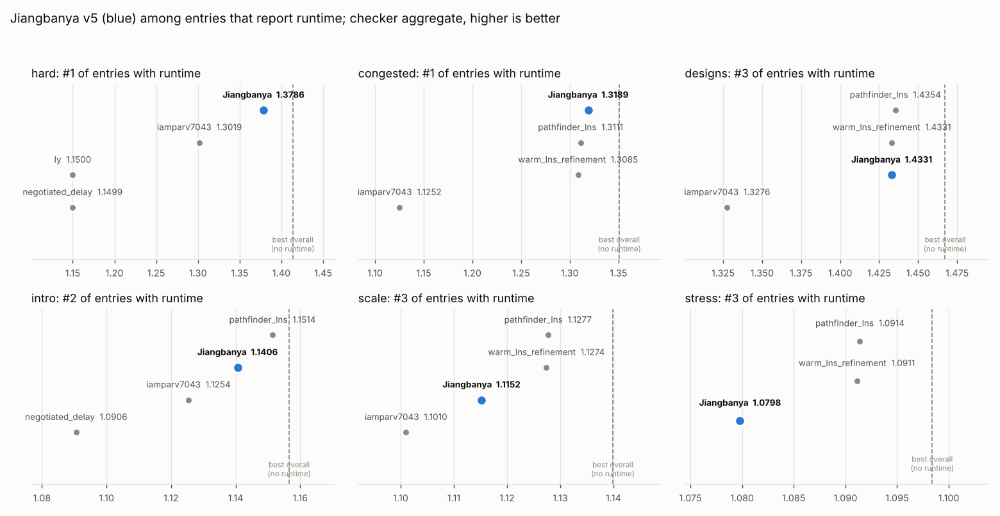

## v5 in six pictures

### 1. The problem: who gets the cheap layers

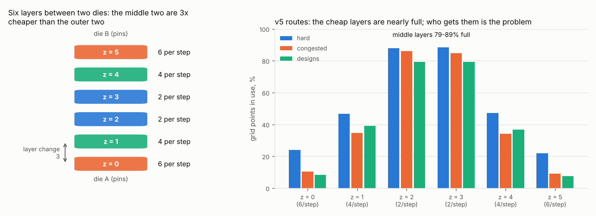

Each net (one driver, several sinks) needs a tree of wires on a 6-layer grid, and no two nets may
share a grid point. Every sink pays for its own driver-to-sink path. A step costs 2 on the two
middle layers and 6 on the outer two, and those middle layers are 79–89% full. So the score
depends on which nets get them.

### 2. Where v5 still loses delay

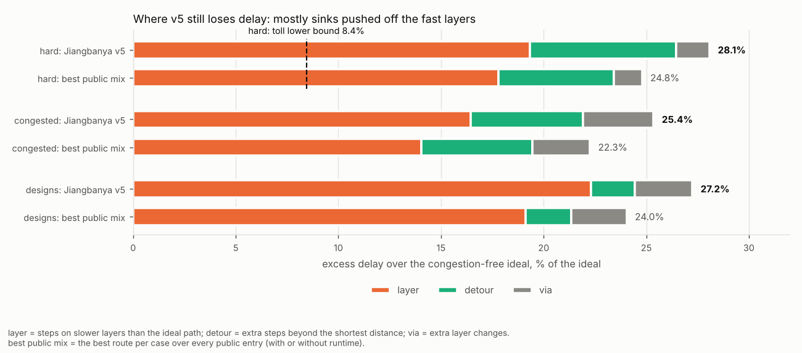

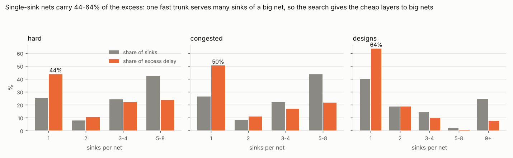

The excess is the delay above each sink's congestion-free cheapest path. v5 is 25–28% above that
ideal; the best route per case over all public entries is 22–25% above it. On hard, the provable
lower bound is 8.4% above it. Most of the excess is sinks pushed onto slower layers (65–82%).
Single-sink nets carry 44–64% of it, because one fast trunk serves every sink of a big net.

### 3. The router

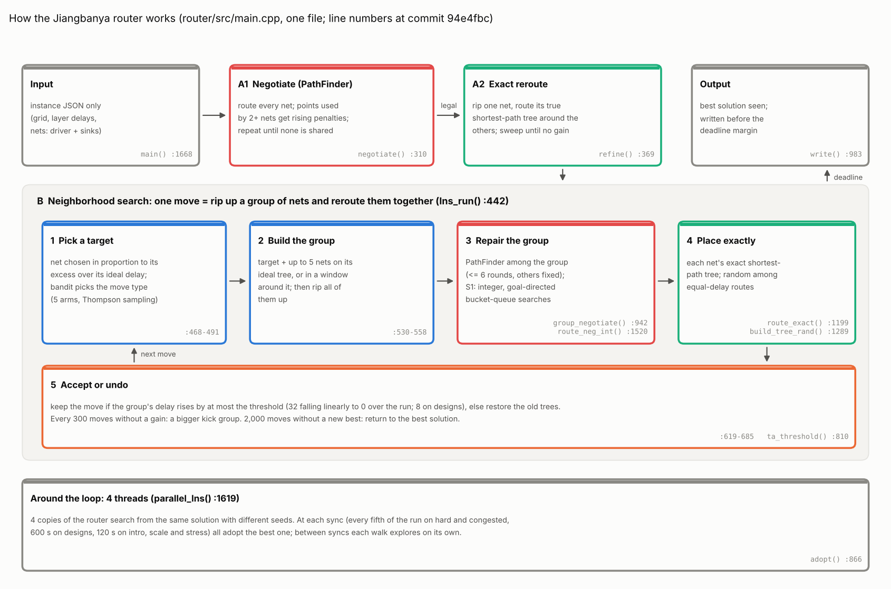

1. **Negotiate (PathFinder).** Grid points used by two or more nets get rising penalties until no
   point is shared.
2. **Exact reroute.** Each net gets its true shortest-path tree around the others.
3. **Neighborhood search** for the rest of the time: rip up a target net and up to 5 neighbors,
   repair them together, then place each one exactly.
   - A move that makes delay worse is kept if it costs at most a threshold. The threshold falls
     linearly to 0 over the run.
   - A bandit picks among the 5 move types.
4. **Four threads** search independently and adopt the best solution at each sync.

### 4. One run, start to finish

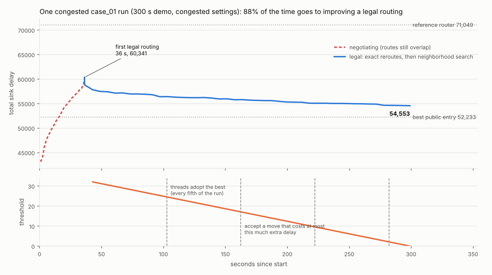

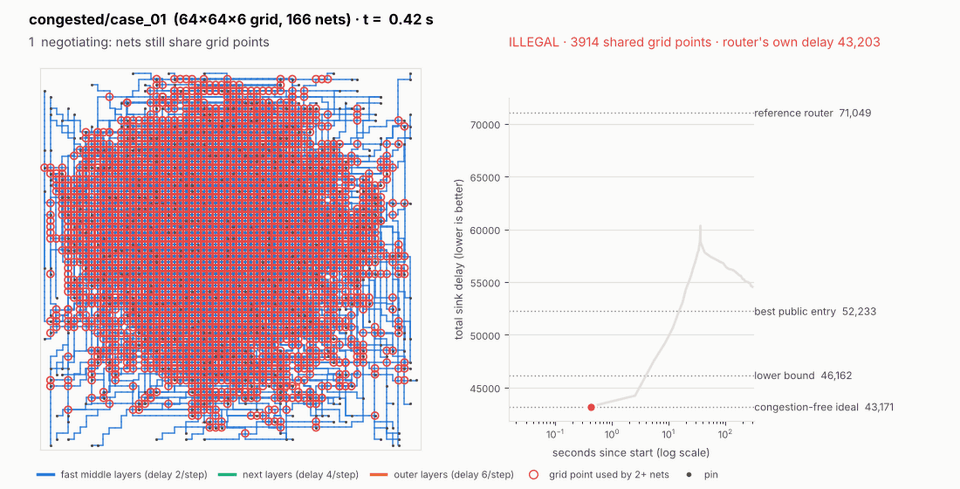

On congested case_01, negotiation reaches a legal routing at 36 s. The remaining 88% of the time
improves it, while the threshold falls from 32 to 0 and the threads sync every fifth of the run.
This 300 s demonstration ends at 54,553. The submitted run took 4,838 s and ends at 53,319.

### 5. What each ingredient bought

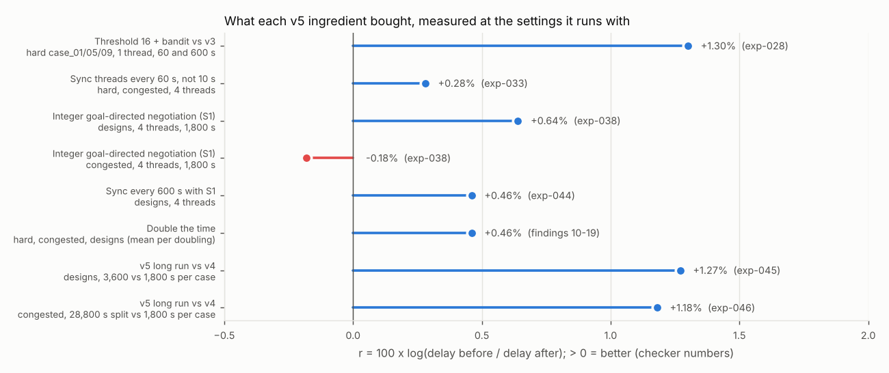

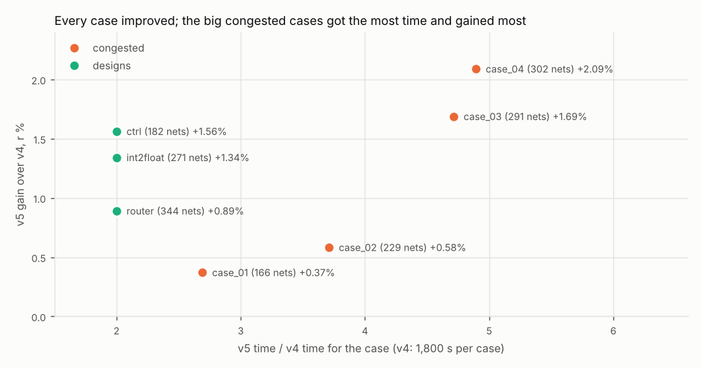

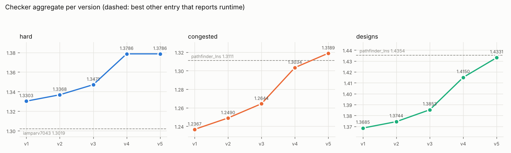

Every lever was measured with checker numbers, at the budget and thread count it runs with. Short
tuning runs picked the wrong winners (exp-027..030).
- The biggest single gains: the threshold plus the bandit (+1.3%), then time.
- More time adds about +0.46% per doubling.
- v5's long runs gained +1.18% on congested and +1.27% on designs over v4. Every case improved,
  and the congested cases given 4.7–4.9× v4's time gained most (+1.7%, +2.1%).

### 6. A routing up close

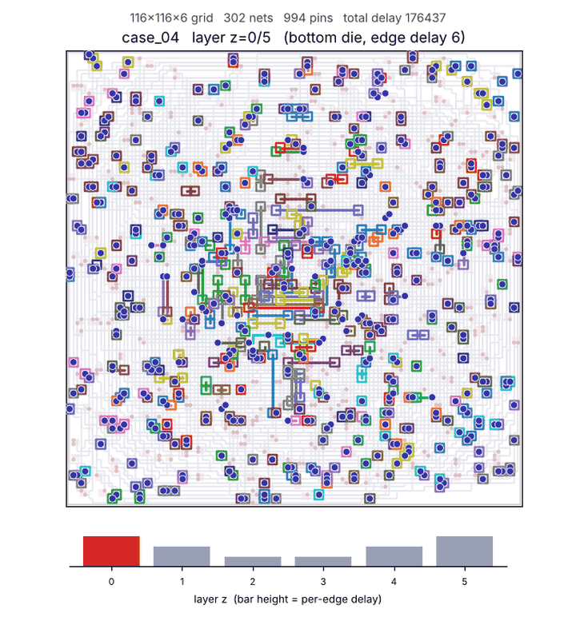

The submitted congested case_04 routing (302 nets, delay 176,437), one layer per frame.

## Settings per tier

All tiers: 4 threads, seed 1, and the v3 base flags: `--set lns=1 --set gneg=6 --set lns_k=6
--set fan_alpha=0.3 --set lns_mix=1 --set tie_rand=1 --set ta_t0=8 --set kick_after=300
--set restore_after=2000 --set gneg_sel=1 --set astar=1 --set par_sync=10`. Later `--set` values
override earlier ones.

| tier | router | time per case | added flags |
|---|---|---|---|
| hard | `457c4df` | 600 s | `ta_t0=32 bandit=1 par_sync=120` |
| congested | `94e4fbc` | 28,800 s split by net count: 4,839 / 6,675 / 8,483 / 8,803 s | `ta_t0=32 bandit=1 par_sync_frac=0.2` |
| designs | `858a703` | 3,600 s | `neg_int=4 neg_goal=1.5 par_sync=600` |
| intro, scale | `858a703` | 60 s, 300 s | `ta_t0=32 bandit=1 par_sync=120 neg_int=4 neg_goal=1.5` |
| stress | `858a703` | 2,400 s | as intro, plus `refine_stop=0.01 deadline_guard=3` |

`neg_int` and `neg_goal` are S1: integer, goal-directed negotiation. S1 helped designs (+0.64% at
1,800 s, exp-038) but not congested (−0.18%), so congested runs without it.

## How the runs were done

- **Input and checks.** One run per case from the instance JSON alone, timed with
  `research/tools/run_router.py`, one case at a time. Each `runtime.json` is the wall clock of that
  run.
- **Hardware.** Cloud VM: Intel Xeon @ 2.10 GHz, 4 vCPU, 16 GB.
- **Congested limits.** Each case's limit is proportional to its net count: limit = 28,800 × nets
  ÷ 988. The formula is in `meta.json` as `time_limit_policy`.
- **Restarts.** The VM restarted four times during congested case_03. That case was started again
  from scratch each time (`run_router.py --resume` keeps finished cases); `run_info.json` lists the
  restarts.

## Auditing the code

See `router/AUDIT.md`: a reading order, the invariants that make a routing legal, and where the
CPU goes (over 95% in shortest-path searches; `route_neg` on hard and congested, `route_neg_int`
on the S1 tiers).

## Reproduce the pictures

```
python3 research/tools/plot_standings.py --out research/models/jiangbanya_v5
python3 research/tools/plot_v5_card.py --out research/models/jiangbanya_v5 \
    --frames research/runs/anim-v5-congested01/frames.csv
python3 research/tools/plot_router_audit.py --profiles research/models/jiangbanya_v5/profile \
    --out research/models/jiangbanya_v5
python3 research/tools/animate_run.py --dir research/runs/anim-v5-congested01 --tier congested \
    --case case_01 --stride 2 --width 960 --out research/models/jiangbanya_v5/run_congested_case01.gif
python3 -m m3d.cli animate --mode layers --case benchmarks_congested/case_04.json \
    --sol submissions/congested/Jiangbanya/case_04.sol.json --out layers_congested_case04.gif
```

The last command runs on the submission branch, where `submissions/congested/Jiangbanya/` lives.

The demonstration run behind the search GIF (300 s, 4 threads):

```
bash research/tools/v4tier.sh router/build/m3d_route congested --instance benchmarks_congested/case_01.json \
    --out D/final.sol.json --time-limit 300 --seed 1 --threads 4 --set par_sync_frac=0.2 \
    --set snap_dir=D --set snap_neg=4 --set snap_s=6
```

## Files

- `submission_all.tar.gz`: all six tiers as `submissions/<tier>/Jiangbanya/`, extracted into the
  submission branch for PR #63.
- `submission_designs.tar.gz`, `submission_congested.tar.gz`: the two long runs on their own.
  Intro, scale and stress are in `../jiangbanya_v5_sparse/`; hard is in `../jiangbanya_v4/`.
- `pr_63_v5.md`: PR title (first line) and description.
- `profile/flat_<tier>.txt`: the gprof profiles behind `router_profile.png` and
  `router_code_map.png`.
- Pictures: `standings_v5.png`, `progress_v1_v5.png`, `v5_*.png`, `router_*.png`, and the two GIFs.
