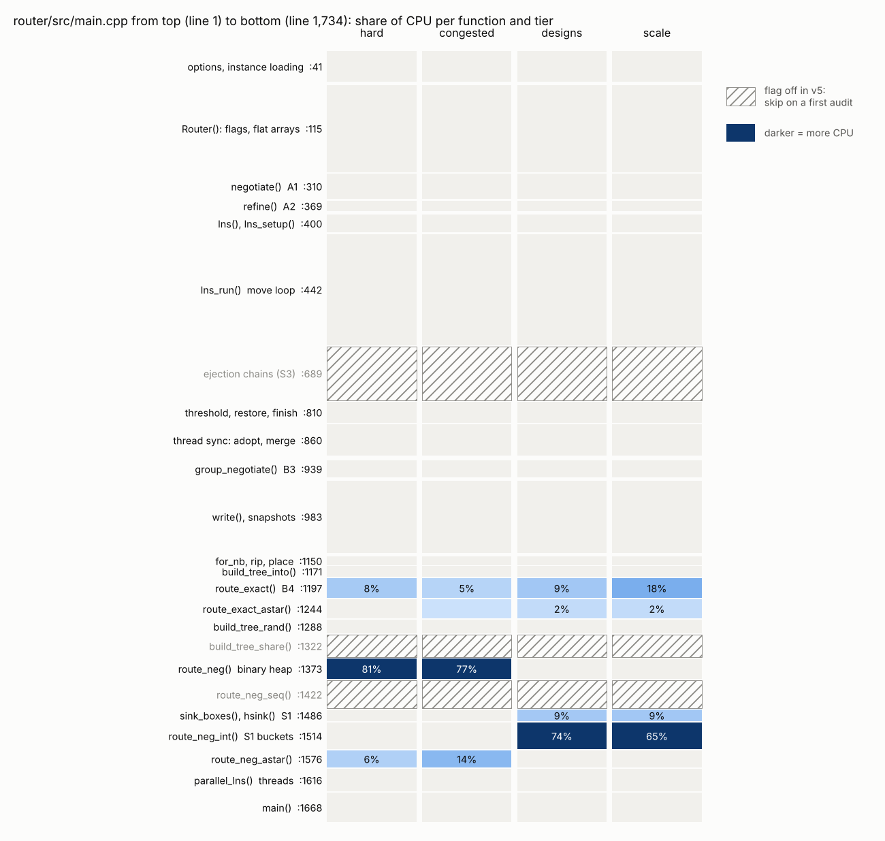
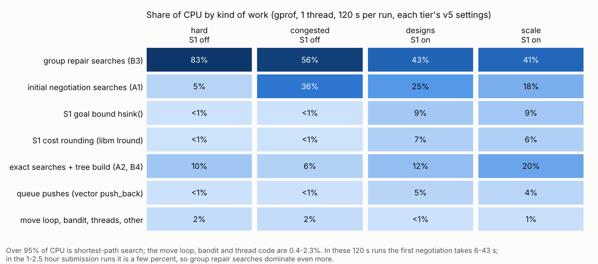

# Auditing the router

The router is one file, `router/src/main.cpp` (1,734 lines at commit `94e4fbc`). Over 95% of its
CPU goes to shortest-path searches in four functions, so start there.

Line numbers below are at `94e4fbc`, the congested commit. The other tiers ran older commits:
- designs, intro, scale and stress ran `858a703`, which lacks only the `par_sync_frac` option;
- hard ran `457c4df`. Each later commit adds a flag that is off on hard and was checked
  byte-identical with it off, except `2f27955`, which only changes behavior at the deadline.

`git log --oneline 457c4df..94e4fbc -- router/src/main.cpp` lists them.





How these were measured: gprof, static `-pg` build, 1 thread, 120 s per run, seed 1, each tier's v5
settings (hard case_05, congested case_01, designs ctrl, scale case_01), four runs at once on the
4-vCPU cloud VM. Shares are of the CPU time gprof sampled (50–70 s per run). In single-thread runs
gprof labels 1–2% of samples as a `std::thread` lambda: that is a symbol artifact, ignore it. Raw
profiles: `research/models/jiangbanya_v5/profile/flat_<tier>.txt`.

## Reading order (about 45 minutes)

| # | where | what to understand |
|---|---|---|
| 1 | `main()` :1668–1734 | The whole program: read flags, `negotiate()`, `refine()`, then `parallel_lns()` (or `lns()` with 1 thread), `write()`. The deadline is the time limit minus a margin (:1706). |
| 2 | `Router()` :115–307 | The data layout. Grid point id `v = (z·H + y)·W + x`. Every per-point state is a flat array of size N: `owner`, `occ` (nets using the point during negotiation), `hist` (history cost), `dist`, `pred`. `seen[v] == stamp_` means "touched in this search", so no array is cleared between searches. Every flag is documented where it is read. |
| 3 | `for_nb()` :1151 | The neighbor generator every search uses: 4 in-layer steps (cost = that layer's delay) and 2 layer changes (via cost). |
| 4 | `route_exact()` :1199 | The reference search: Dial's bucket queue (integer step costs ≤ 6, so a ring of 7 buckets). **Legality hinges on :1219–1220**: a search never enters a point owned by another net. Then `build_tree_rand()` :1289 builds the tree, picking at random among equal-delay predecessors. |
| 5 | the hot search for your tier | hard and congested: `route_neg()` :1376, a binary heap on doubles, with step cost `(delay + hist) × (1 + pf × occ)` (:1402); 81% / 77% of CPU. Designs, intro, scale, stress (S1 on): `route_neg_int()` :1520 with `hsink()` :1504, a bucket queue on integer-scaled costs with a goal bound; 65–74% plus 9%. |
| 6 | `group_negotiate()` :942 | How a ripped group is repaired: up to `gneg` (6) PathFinder rounds among the group, everything else fixed. |
| 7 | `lns_run()` :442–687 | One move: pick a target :468–491, build the group :530–558, repair :574–592, accept test :619–637, undo :679–684. |
| 8 | `parallel_lns()` :1619, `adopt()` :866 | Threads: each worker is a full `Router` copy (:1625), so nothing is shared while they run; they meet only after `join` (:1643), and the others adopt the best. |

## Correctness invariants (these decide legality)

- **Pins stay put.** `rip()` never frees a pin (:1165–1168). Every search refuses other nets' pins
  (:1219, :1399, :1547).
- **One net per point.** Only `route_exact` places trees, and it enters only free points or the
  net's own (:1219–1220). Negotiated trees, including S1's inexact goal-directed ones (`neg_goal`
  > 1), are proposals: the group is re-placed through `route_exact` (:578–583) before anything is
  kept.
- **Undo is exact.** A rejected move restores the old trees and owners (:679–684).
- **Negotiation ends only when legal.** The loop exits when no point has `occ > 1` (:333–339);
  `owner` is rebuilt from the trees (:358–364).
- **Deadline.** Every loop checks the clock: negotiation :340, sweeps :372/:377, moves :446–449. The
  file is written after the search (:1725), inside the margin.
- **Determinism.** One RNG per `Router`; thread t is seeded `seed × 1000003 + t` (:1626). With 1
  thread and a move cap (`--set max_iters=N`), output is byte-identical (`router/tests/run_tests.sh`
  checks this). With 4 threads, syncs happen on wall-clock time, so runs differ.
- **Typos fail loudly.** An unknown `--set` key exits with an error (`check_unused()` :60).
- **The checker is the referee.** The router's printed delay is not trusted. Score any change with
  `research/tools/evaluate.py` or `python -m m3d.cli score-suite`.

## Hot spots and leads (measured, not yet changed)

1. **`route_neg()` on hard and congested (77–81%).** Each relaxation does a `push_heap`. The S1
   bucket-queue version exists (`neg_int=4`), but it did not help at those tiers' budgets
   (exp-036/038): those searches are saturated, so speed alone does not raise the score there.
2. **`hsink()` (9% with S1).** It is called for every relaxed neighbor and loops over all 6 layers to
   find the nearest sink layer (:1509–1510). Lead: compute the layer gap per layer once per search
   (6 integers), then look it up.
3. **`lround` (6–7% with S1).** `std::lround` at :1551 compiles to a libm call per relaxation (see
   `objdump -d router/build/m3d_route | grep lround`). Lead: `static_cast<int>(x + 0.5)` (costs
   are positive). It can differ from `lround` in rare floating-point edge cases, so re-score any
   change with the checker.
4. **Queue pushes (4–5% with S1).** The bucket vectors keep their capacity between searches, so
   this is the per-push bookkeeping, not allocation.
5. **`route_exact()` (5–18%).** It is highest on scale, the biggest grid.

**Looks expensive, isn't (under 1% combined):**
- the per-move excess scan over all nets (:468–471);
- the bandit's 10 gamma samples per move (:476–480);
- best-solution copies (:502–505, :672–675);
- thread sync.

## Code you can skip on a first pass (flags off in v5)

| code | lines | flag (v5 value) |
|---|---|---|
| ejection chains (S3) | :689–808 | `ej_p` (0) |
| `merge_from()` | :877–913 | `par_merge` (0) |
| `build_tree_share()` | :1325–1371 | `tie_share` (0) |
| `route_neg_seq()` | :1426–1484 | `tree_seq` (0) |
| pressure shaping, `update_pressure()` | :817–825 | `shape_g` (0) |
| late acceptance, record-to-record | :622–627 | `acc` (0) |
| annealing | :459, :636 | `sa_t0` (0) |
| rate-controlled threshold | :659–660 | `ta_rate` (0) |

## Profile it yourself

On your Mac (Instruments; gprof is not available there):

```
make -C router
xcrun xctrace record --template 'Time Profiler' --output designs.trace --launch -- \
  router/build/m3d_route --instance benchmarks_designs/ctrl.json --out /tmp/x.sol.json \
  --time-limit 120 --seed 1 --threads 1 --set lns=1 --set gneg=6 --set lns_k=6 --set fan_alpha=0.3 \
  --set lns_mix=1 --set tie_rand=1 --set ta_t0=8 --set kick_after=300 --set restore_after=2000 \
  --set gneg_sel=1 --set astar=1 --set par_sync=600 --set neg_int=4 --set neg_goal=1.5 --set verbose=1
open designs.trace
```

In Instruments, select the main thread, then use Call Tree → Invert Call Tree. The top rows should
be `route_neg_int`, `route_exact`, `hsink` and `lround`, as in the table above.

On Linux (how the numbers above were made):

```
g++ -O2 -std=c++20 -ffp-contract=off -pthread -pg -static -o m3d_pg router/src/main.cpp
bash research/tools/v4tier.sh ./m3d_pg designs --instance benchmarks_designs/ctrl.json \
  --out /tmp/x.sol.json --time-limit 120 --seed 1 --threads 1 --set verbose=1 \
  --set neg_int=4 --set neg_goal=1.5 --set par_sync=600
gprof -b -p ./m3d_pg gmon.out | head -30
python3 research/tools/plot_router_audit.py --profiles research/models/jiangbanya_v5/profile \
  --out research/models/jiangbanya_v5
```

With `--set verbose=1`, stderr ends with one `STAT` line per move type (tries, share accepted,
share improved, microseconds per move) and an `ARMS` line (bandit choices). Router tests:
`bash router/tests/run_tests.sh` (legal on 6 cases plus the determinism check).
